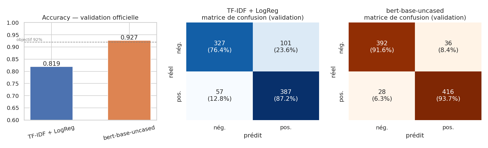
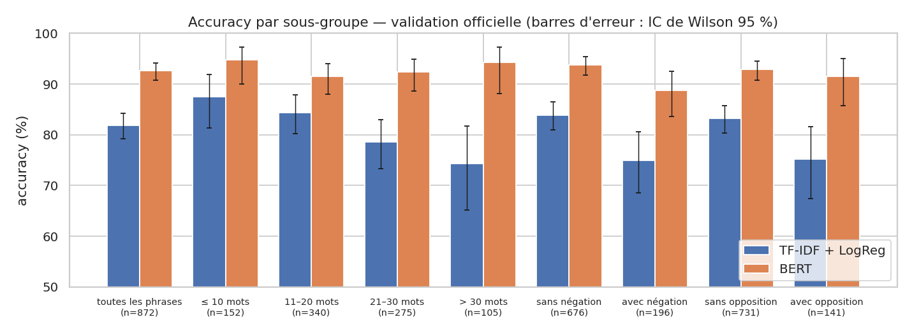

# BERT contre TF-IDF pour l'analyse de sentiment (SST-2)

Fine-tuning de `bert-base-uncased` sur SST-2 (GLUE), comparé à une baseline TF-IDF + régression logistique et à BERT gelé, avec une évaluation statistique appariée et une analyse d'erreurs détaillée. BERT fine-tuné atteint 92,66 % d'accuracy en validation, contre 81,88 % pour la baseline.

## English summary

Sentiment classification on SST-2 with three approaches: a TF-IDF + logistic regression baseline, frozen BERT features with logistic regression, and fully fine-tuned `bert-base-uncased` (PyTorch training loop, mixed precision on a T4 GPU). All choices are made on an internal dev split built by phrase groups to avoid leakage; the official validation set is evaluated once per model. Fine-tuned BERT reaches 92.66% accuracy versus 81.88% for the baseline (+10.8 points, paired bootstrap 95% CI [+8.1, +13.4], exact McNemar p = 3.4e-15), stable across three seeds. The repository also covers frozen vs fine-tuned BERT, minimal-pair tests for negation, probability calibration and a manual error analysis.

## Résultats

Validation officielle de SST-2 (872 phrases), exécution complète sur Google Colab, GPU Tesla T4.

| Modèle | Accuracy | F1 | ROC-AUC |
|---|--:|--:|--:|
| TF-IDF + régression logistique | 81,88 % | 0,831 | 0,912 |
| BERT gelé (moyenne des jetons) + régression logistique | 85,32 % | 0,858 | 0,937 |
| BERT fine-tuné | 92,66 % | 0,929 | 0,976 |

- Le gain de BERT fine-tuné sur la baseline est de +10,78 points (IC bootstrap apparié à 95 % : [+8,14 ; +13,42], McNemar exact p = 3,4 × 10⁻¹⁵).
- Il tient sur trois graines : de 92,43 % à 93,12 %, écart-type de 0,35 point.
- Sans aucun fine-tuning, les vecteurs de BERT battent déjà la baseline. Le fine-tuning complet leur ajoute ensuite +7,3 points (IC [+5,2 ; +9,4]).
- BERT fait ses erreurs de façon équilibrée (36 faux positifs, 28 faux négatifs). La baseline penche vers la classe positive (101 contre 57).

## Ce que l'analyse d'erreurs apporte

Un score global ne dit pas où un modèle se trompe. Nous avons donc testé des hypothèses précises plutôt que de lire quelques exemples.

- Le seul avantage de BERT établi statistiquement porte sur les phrases de plus de 30 mots : +10,5 points de plus qu'ailleurs (IC [+2,3 ; +19,1]). Pour la négation, l'opposition et les mots hors vocabulaire, l'écart va dans le même sens mais son intervalle contient 0.
- Sur 276 phrases construites par paires (« the movie is good » / « the movie is not good »), BERT inverse sa prédiction dans 100 % des cas. La baseline le fait dans 43 % des cas avec « not » et jamais avec « n't », que son découpage en mots écarte.
- BERT est trop sûr de lui : 62,5 % de ses erreurs ont une confiance d'au moins 0,9. Un *temperature scaling* ajusté sur dev (T = 1,68) fait passer l'erreur de calibration (ECE) de 0,048 à 0,013 sans changer aucune prédiction.
- Les 64 erreurs de BERT ont été lues une à une et classées par cause : étiquette discutable (18), avis mitigé (14), ironie (11), négation (9), vocabulaire rare (6), autre (6).

## Méthode

- Données : SST-2 depuis Hugging Face (67 349 syntagmes d'entraînement, 872 phrases de validation). Le test GLUE n'a pas d'étiquettes publiques et n'est pas utilisé.
- Nettoyage des doublons et des étiquettes contradictoires, puis découpage du jeu de développement par groupes de syntagmes issus d'une même phrase. La contamination entre entraînement et dev tombe ainsi de 84 % à 0,05 %.
- Baseline : TF-IDF (unigrammes et bigrammes) et régression logistique, hyper-paramètres choisis sur dev.
- BERT : boucle d'entraînement PyTorch écrite à la main (AdamW, taux d'apprentissage 2 × 10⁻⁵, warm-up, gradient clipping, précision mixte fp16), trois époques, meilleure époque choisie sur dev. L'entraînement dure environ 11 minutes sur un T4.
- Évaluation : intervalles de Wilson, test exact de McNemar et bootstrap apparié (5 000 tirages) pour toutes les comparaisons. Une différence n'est dite significative que si son intervalle exclut 0.

Le rapport (`rapport/`) détaille chaque choix, les résultats et les limites.

## Outils

Python, PyTorch, Hugging Face `transformers` et `datasets`, scikit-learn, SciPy, pandas, matplotlib et seaborn, Google Colab (GPU T4).

## Reproduire

Le bouton « Ouvrir dans Colab » lance le notebook. Choisir un GPU T4 (Exécution > Modifier le type d'exécution), puis tout exécuter : la première cellule installe les dépendances. L'exécution complète prend environ 50 minutes, dont la moitié pour les deux graines supplémentaires ; mettre `RUN_EXTRA_SEEDS = False` dans la cellule de paramètres pour aller plus vite. La dernière cellule télécharge une archive avec les mêmes fichiers que `resultats/`.

En local (Python 3.10 ou plus) : `pip install -r requirements.txt`. Sans GPU, le fine-tuning complet prend plusieurs heures.

## Organisation du dépôt

| Chemin | Contenu |
|---|---|
| `notebook/bert_vs_tfidf_sst2.ipynb` | notebook complet, exécuté, avec toutes ses sorties |
| `rapport/rapport_bert_sst2.pdf` | rapport technique de 16 pages |
| `rapport/rapport_bert_sst2.md` | le même rapport en Markdown, lisible sur GitHub |
| `resultats/` | métriques (JSON), prédictions par phrase (CSV), figures, annotation des erreurs |

## Limites

L'évaluation repose sur les 872 phrases de validation, faute d'étiquettes pour le test, ce qui donne des intervalles de plusieurs points. Les analyses par sous-groupe sont exploratoires et sans correction pour tests multiples, et la classification des erreurs par cause repose sur une seule lecture. Nos expériences ne permettent pas non plus d'isoler le rôle de l'attention dans l'avantage de BERT.

## Contexte et équipe

Projet réalisé en novembre 2026 à l'École Centrale Casablanca (option S2D), dans le cadre du cours de NLP sur le Transformer et BERT, par HABBANI Mohammed, BEN ALLA Ilyas et ETTAHIRI Mohammed-Yassine.

## Références

- Devlin, J., Chang, M.-W., Lee, K. et Toutanova, K. (2019). BERT: Pre-training of Deep Bidirectional Transformers for Language Understanding. NAACL-HLT.
- Socher, R. et al. (2013). Recursive Deep Models for Semantic Compositionality Over a Sentiment Treebank. EMNLP.
- Wang, A. et al. (2019). GLUE: A Multi-Task Benchmark and Analysis Platform for Natural Language Understanding. ICLR.
- Guo, C., Pleiss, G., Sun, Y. et Weinberger, K. Q. (2017). On Calibration of Modern Neural Networks. ICML.
- Ribeiro, M. T., Wu, T., Guestrin, C. et Singh, S. (2020). Beyond Accuracy: Behavioral Testing of NLP Models with CheckList. ACL.
