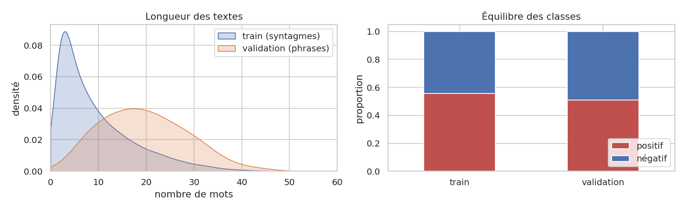
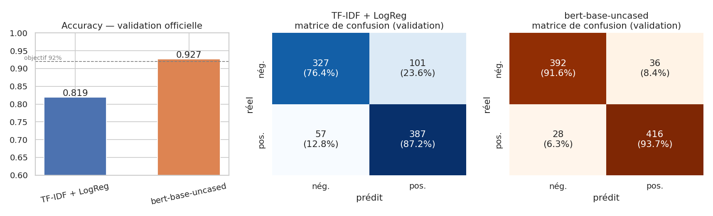
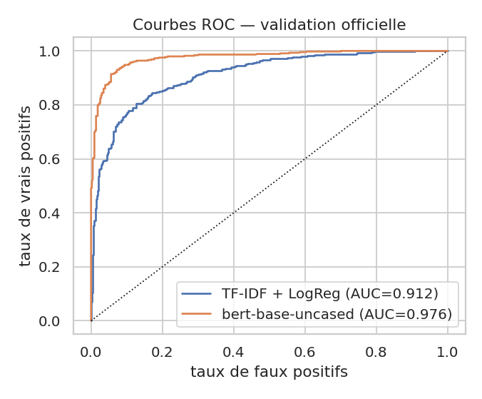
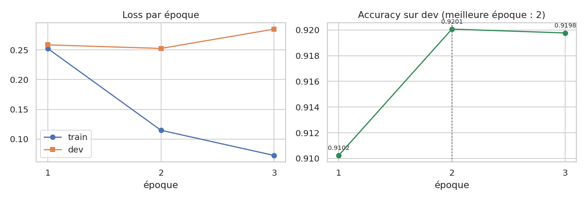
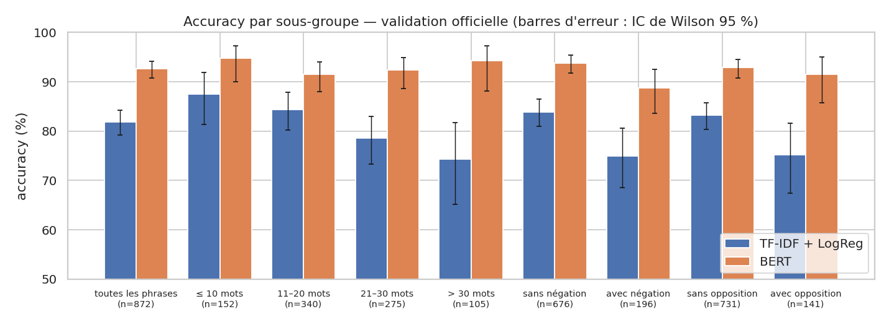
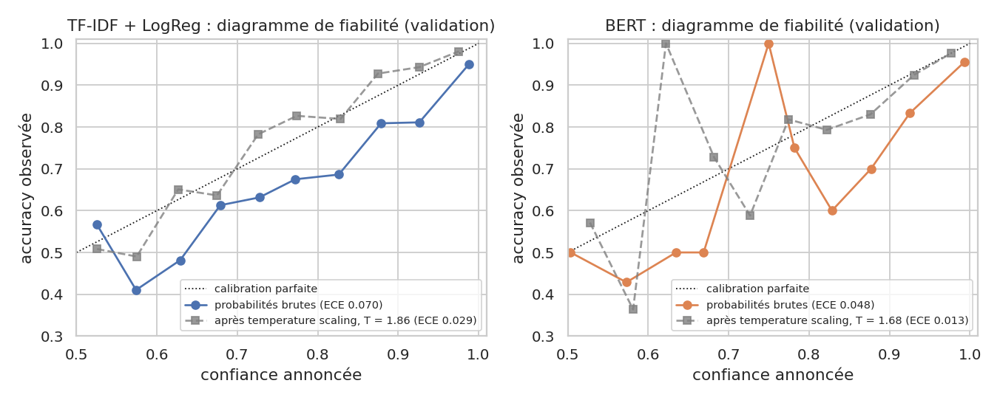

# Résumé

Nous classons le sentiment des phrases de SST-2, la tâche de critiques de films du benchmark GLUE, avec trois approches : une baseline TF-IDF + régression logistique, BERT gelé suivi d'une régression logistique, et bert-base-uncased fine-tuné. Tous les choix (hyper-paramètres, époque, variante) se font sur un jeu de développement interne (dev), et la validation officielle n'est évaluée qu'une fois par modèle.

Sur les 872 phrases de validation, la baseline atteint 81,88 % d'accuracy et BERT fine-tuné 92,66 %. L'écart vaut +10,78 points, avec un IC bootstrap apparié à 95 % de [+8,14 ; +13,42] points (McNemar exact : p = 3,43 × 10⁻¹⁵). Répété sur trois graines, le fine-tuning donne 92,74 % en moyenne (écart-type de 0,35 point). BERT gelé atteint 85,32 % : il dépasse déjà la baseline, mais le fine-tuning complet lui ajoute +7,3 points.

L'analyse des erreurs montre un avantage de BERT plus marqué sur les phrases de plus de 30 mots. Sur des paires minimales, BERT inverse toujours sa prédiction quand on ajoute une négation. Ses erreurs restantes tiennent surtout à des étiquettes discutables, des avis mitigés et de l'ironie. Le test officiel n'ayant pas d'étiquettes publiques, toute l'évaluation repose sur la validation officielle.

*Mots-clés : BERT, Transformer, SST-2, GLUE, classification de sentiment, TF-IDF, fine-tuning, BERT gelé, analyse des erreurs.*

> BERT arrive sur SST-2 avec ce qu'il a appris en devinant des mots masqués (MLM) dans 3,3 milliards de mots. Ses vecteurs pré-entraînés, sans aucune adaptation, battent déjà la baseline : 85,32 % contre 81,88 %. C'est vrai même du vecteur `[CLS]` gelé, dont la sortie n'a servi au pré-entraînement qu'à prédire si une phrase en suit une autre. Le fine-tuning ajoute une tête de 1 538 paramètres sur `[CLS]` et ajuste les 110 M de poids avec un petit taux d'apprentissage : l'accuracy monte à 92,66 %, soit +7,3 points de plus que la version gelée. C'est l'adaptation de tout le réseau, plus que les vecteurs pré-entraînés, qui fait la plus grande part de l'écart avec TF-IDF. Le résultat tient sur trois graines. Sur les phrases qui contiennent un mot hors du vocabulaire de la baseline, que WordPiece découpe sans difficulté, l'avantage de BERT n'est pas plus grand qu'ailleurs. Parmi les erreurs qui restent, beaucoup ne peuvent pas être tranchées à partir de la phrase seule.

# 1. Introduction

Pour dire si une critique est positive ou négative, une représentation TF-IDF décrit le texte par les mots et les bigrammes qu'il contient, sans tenir compte de leur ordre au-delà de deux mots. BERT produit au contraire une représentation de chaque mot qui dépend de toute la phrase, apprise au préalable sur un grand corpus. Ce TP mesure ce que cette différence change sur SST-2, dans un protocole identique pour les modèles comparés.

La consigne du module 7 fixe le cadre : SST-2 (environ 67 000 exemples de critiques de films), le modèle bert-base-uncased et les bibliothèques `transformers`, `datasets` et scikit-learn. Il faut battre la baseline TF-IDF + régression logistique, atteindre environ 92 % d'accuracy en validation, puis comprendre les erreurs. Le mail du délégué demande trois livrables : un notebook avec le code BERT, le reporting des performances du modèle et la comparaison avec la baseline TF-IDF + régression logistique.

Tableau : exigences du TP et constats

| Exigence du TP | Critère vérifiable | Constat |
|---|---|---|
| Baseline classique | TF-IDF + régression logistique | 81,88 % en validation |
| Fine-tuning d'un Transformer | bert-base-uncased, 3 époques | 92,66 %, objectif atteint |
| Stabilité du résultat | trois graines | de 92,43 % à 93,12 % |
| Bonus du cours | BERT gelé contre fine-tuning complet | 85,32 % contre 92,66 % |
| Comprendre les erreurs | dix phrases regroupées par cause | section 6 |

Nous cherchons à savoir dans quelles situations l'adaptation de BERT améliore la prédiction par rapport à un classifieur fondé sur des caractéristiques lexicales, et d'où vient cette amélioration.

# 2. Données et protocole expérimental

## 2.1 SST-2 officiel

Le notebook charge SST-2 depuis Hugging Face, avec un repli vers nyu-mll/glue (Socher et al., 2013 ; Wang et al., 2019). Le train officiel contient 67 349 syntagmes annotés, la validation 872 phrases complètes et le test 1 821 phrases dont les étiquettes sont masquées (valeur −1). Aucun score de test n'est donc rapporté. La validation officielle sert d'évaluation finale et n'intervient dans aucun choix.

Tableau : rôle de chaque jeu de données

| Jeu | Effectif | Rôle |
|---|--:|---|
| Train officiel | 67 349 | source des données d'apprentissage et de développement |
| train_fit | 63 620 | apprentissage de tous les modèles |
| dev interne | 3 353 | choix des hyper-paramètres, de l'époque et de la variante gelée |
| Validation officielle | 872 | évaluation finale, une fois par modèle, et analyse des erreurs |
| Test officiel | 1 821 | étiquettes masquées, non utilisé |

## 2.2 Exploration et nettoyage

Les syntagmes du train comptent en moyenne 9,4 mots, contre 19,5 pour les phrases de validation (médianes : 7 et 19). Le train contient beaucoup de fragments de phrases, la validation des phrases entières : c'est un décalage de distribution qu'il faut garder en tête. La validation compte 50,9 % d'exemples positifs, contre 55,8 % dans le train. Parmi les mots distincts de la validation, 21,7 % n'apparaissent jamais dans le train (5,7 % des occurrences). Les marqueurs de négation sont aussi plus fréquents en validation (22,5 % des phrases) que dans le train (10,3 %).

Le nettoyage retire 10 exemples appartenant à 5 phrases portant des étiquettes contradictoires, puis 366 doublons exacts. Aucun exemple du train n'est identique à une phrase de validation ; il reste 66 973 exemples avant le découpage interne.

## 2.3 Découpage interne par groupes

Les sous-syntagmes du train proviennent souvent d'une même phrase source. Un découpage aléatoire mettrait des fragments d'une même phrase des deux côtés et gonflerait le score sur dev. Le notebook regroupe donc les expressions selon leur inclusion dans les phrases les plus longues et sépare des groupes entiers (354 groupes dans dev). Sur l'indicateur retenu (syntagmes de dev d'au moins cinq mots contenus dans une phrase d'entraînement), la contamination tombe à 0,05 %, contre 84,0 % avec un découpage aléatoire. Ce contrôle mesure une fuite précise ; il ne prouve pas l'absence de toute dépendance entre les jeux.

# 3. Méthodes

## 3.1 Baseline TF-IDF + régression logistique

Le texte est représenté en sac de mots pondéré par TF-IDF : un mot fréquent dans la phrase mais rare dans le corpus reçoit un poids élevé, et les bigrammes rendent un peu d'ordre (« not good »). Le `TfidfVectorizer` utilise une pondération sous-linéaire et une fréquence documentaire minimale de 2. Dix combinaisons sont évaluées sur dev : unigrammes ou unigrammes + bigrammes, avec C ∈ {0,3 ; 1 ; 3 ; 10 ; 30}. La configuration retenue utilise les n-grammes (1-2) et C = 30, avec 80,97 % sur dev et 71 017 caractéristiques. La régression logistique attribue un poids à chaque caractéristique, ce qui rend le modèle lisible : en section 5 du notebook, le bigramme « not bad » reçoit un poids nettement positif. Le cours recommande de toujours lancer ce type de modèle en premier. Ses limites tiennent à sa représentation : deux synonymes n'ont rien en commun, un mot jamais vu à l'entraînement est ignoré et le contexte au-delà de deux mots est perdu.

## 3.2 Architecture de BERT et tokenisation

bert-base-uncased est un encodeur Transformer (Vaswani et al., 2017 ; Devlin et al., 2019) de 12 couches, avec des représentations de dimension 768 et 12 têtes d'attention, soit environ 110 M de paramètres (109 millions selon le comptage du notebook). Dans chaque couche, l'auto-attention calcule pour chaque jeton un mélange pondéré des représentations de tous les autres, à gauche comme à droite ; la représentation d'un mot dépend donc de la phrase entière. Le modèle a été pré-entraîné sur 3,3 milliards de mots avec deux tâches : retrouver 15 % de jetons masqués à partir de leur contexte (MLM) et prédire, depuis le jeton `[CLS]`, si une phrase en suit une autre (NSP).

BERT ne lit pas des mots mais des unités WordPiece tirées d'un vocabulaire de 30 522 entrées. Un mot rare est découpé en morceaux connus, marqués par le préfixe `##`. Le tokenizer place `[CLS]` en tête et `[SEP]` en fin de phrase, complète les phrases courtes d'un lot par `[PAD]` (rembourrage) et fournit un masque d'attention nul sur ces positions. La section 6.1 du notebook mesure ce découpage sur la validation : 30,2 % des 4 339 mots distincts sont découpés en plusieurs unités, et c'est le cas de 61,7 % des 940 mots absents du train. La validation ne produit aucun jeton `[UNK]` (0) et compte 1,18 unités par mot en moyenne. Là où TF-IDF ignore un mot inconnu, BERT en voit donc toujours des morceaux.

## 3.3 Fine-tuning

Une couche linéaire de 768 × 2 poids et 2 biais, soit 1 538 nouveaux paramètres, est posée sur la représentation de `[CLS]` (après la couche dense pré-entraînée appelée *pooler*). Pendant le fine-tuning, tous les poids du réseau sont ajustés, avec un petit taux d'apprentissage. Le tableau 3 donne la configuration.

Tableau : configuration du fine-tuning

| Paramètre | Configuration |
|---|---|
| Modèle et longueur maximale | bert-base-uncased, 128 jetons |
| Optimisation | AdamW, taux d'apprentissage 2 × 10⁻⁵ |
| Régularisation | weight decay de 0,01, hors biais et LayerNorm |
| Entraînement | 3 époques, lots de 32, graine 42 |
| Planification | warm-up sur 10 % des pas, puis décroissance linéaire |
| Stabilité | gradient clipping (norme 1,0) |
| Calcul | Tesla T4, précision mixte fp16 avec GradScaler |
| Sélection | meilleure accuracy sur dev, départage par la perte |

La boucle PyTorch est écrite explicitement plutôt qu'avec `Trainer` : chaque étape (passage avant, perte d'entropie croisée, rétropropagation, pas de l'optimiseur) reste visible, avec `model.train()` en apprentissage et `model.eval()` sous `torch.no_grad()` en évaluation. Le meilleur checkpoint sur dev est sauvegardé puis rechargé avant l'évaluation finale. Le cours suggère deux époques ; nous en faisons trois et laissons dev choisir la meilleure. Le cours propose aussi `max_len = 64`. Nous gardons 128 : le texte le plus long mesuré compte 62 jetons, 0,00 % des textes dépassent la limite, et avec le rembourrage dynamique par lot cette marge ne coûte rien.

## 3.4 BERT gelé

Le cours propose de comparer le fine-tuning complet à une version où BERT reste gelé et où seule une couche de classification est apprise. Nous encodons les jeux train_fit, dev et validation avec le BERT pré-entraîné, sans aucune adaptation, puis nous entraînons une régression logistique sur ces vecteurs standardisés, ce qui se rapproche d'un entraînement de la seule tête. Deux représentations sont testées : le vecteur de sortie de `[CLS]` et la moyenne des vecteurs de tous les jetons non masqués. Le paramètre C est choisi sur dev dans {0,01 ; 0,1 ; 1 ; 10} (C = 0,10 pour `[CLS]`, C = 0,01 pour la moyenne), puis la variante retenue est celle qui a la meilleure accuracy sur dev. L'encodage des trois jeux prend 0,8 min sur le T4 et la cellule entière 2,5 min.

## 3.5 Évaluation et tests statistiques

Chaque modèle est évalué une seule fois sur la validation officielle. Nous rapportons l'accuracy, la précision, le rappel et le F1 de la classe positive, le F1 macro et l'aire sous la courbe ROC, avec un intervalle de Wilson à 95 % pour l'accuracy (Wilson, 1927). Deux modèles se comparent sur les mêmes phrases. Le test exact de McNemar ne regarde que les phrases où ils divergent (McNemar, 1947 ; Dietterich, 1998). Un bootstrap apparié de 5 000 tirages donne un IC à 95 % de l'écart d'accuracy (Efron et Tibshirani, 1993). Une différence n'est dite significative que si cet intervalle exclut 0.

Ces tests mesurent l'incertitude due à l'échantillon de 872 phrases, pas celle due à l'entraînement. Pour cette seconde question, le fine-tuning est répété avec les graines 43 et 44. Pour les sous-groupes, nous calculons la différence des écarts (écart BERT − baseline dans le groupe moins écart hors du groupe) avec un IC bootstrap. Enfin, la qualité des probabilités est mesurée par l'erreur de calibration attendue (ECE, sur 10 tranches de confiance) et le score de Brier, avant et après un *temperature scaling* ajusté sur dev (Guo et al., 2017).

# 4. Résultats

## 4.1 Comparaison des modèles sur la validation officielle

Tableau : résultats sur les 872 phrases de la validation officielle

| Modèle | Accuracy | IC Wilson à 95 % | Précision | Rappel | F1 | F1 macro | ROC-AUC |
|---|--:|--:|--:|--:|--:|--:|--:|
| TF-IDF + LogReg | 81,88 % | [79,2 % ; 84,3 %] | 0,793 | 0,872 | 0,830 | 0,818 | 0,912 |
| BERT gelé, `[CLS]` | 86,35 % | [83,9 % ; 88,5 %] | 0,857 | 0,878 | 0,868 | 0,863 | 0,937 |
| BERT gelé, moyenne | 85,32 % | [82,8 % ; 87,5 %] | 0,843 | 0,874 | 0,858 | 0,853 | 0,937 |
| BERT fine-tuné | 92,66 % | [90,7 % ; 94,2 %] | 0,920 | 0,937 | 0,929 | 0,927 | 0,976 |

BERT fine-tuné dépasse la baseline sur toutes les métriques : +10,78 points en accuracy et +0,063 en ROC-AUC. Il dépasse aussi le niveau d'environ 92 % fixé par la consigne. Le gain le plus net porte sur la précision (+12,7 points) : la baseline classe trop de phrases en positif. Pour situer ces chiffres, Devlin et al. (2019) rapportent 93,5 % sur le test SST-2 avec BERT-base ; le cours indique qu'on doit obtenir un résultat du même ordre en validation.

## 4.2 Matrices de confusion et courbes ROC

BERT commet 64 erreurs : 36 faux positifs et 28 faux négatifs. Ses erreurs sont donc à peu près équilibrées entre les deux classes, ce que le cours attend d'un bon modèle. La baseline en commet 158, dont 101 faux positifs et 57 faux négatifs : elle penche nettement vers la classe positive, majoritaire dans le train.

## 4.3 Dynamique d'apprentissage

Tableau : évolution du fine-tuning par époque (graine 42)

| Époque | Perte train | Perte dev | Accuracy dev | Temps cumulé |
|--:|--:|--:|--:|--:|
| 1 | 0,2525 | 0,2586 | 91,02 % | 3,8 min |
| 2 | 0,1149 | 0,2525 | 92,01 % | 7,3 min |
| 3 | 0,0724 | 0,2850 | 91,98 % | 10,8 min |

L'époque 2 a la meilleure accuracy sur dev et c'est elle qui est retenue. À l'époque 3, l'accuracy sur dev ne bouge presque plus. La perte sur dev remonte, alors que la perte d'entraînement continue de baisser. Le modèle commence à surapprendre, sans que l'accuracy en souffre encore ; c'est cohérent avec les deux à quatre époques conseillées par le cours.

## 4.4 Variabilité entre graines

Tableau : fine-tuning répété avec trois graines

| Graine | Accuracy dev | Accuracy validation |
|--:|--:|--:|
| 42 | 92,01 % | 92,66 % |
| 43 | 92,25 % | 92,43 % |
| 44 | 92,60 % | 93,12 % |
| Moyenne | 92,29 % | 92,74 % |

Avec les trois graines, l'accuracy de validation va de 92,43 % à 93,12 %, pour un écart-type de 0,35 point. L'objectif d'environ 92 % est atteint à chaque fois. Sur la validation, la graine 42, celle de toutes les analyses suivantes, n'est ni la meilleure ni la moins bonne. Même la moins bonne graine reste loin au-dessus de la baseline (81,88 %).

## 4.5 BERT gelé contre fine-tuning complet

Sur dev, la moyenne des jetons (85,74 %) devance de peu le vecteur `[CLS]` (85,65 %) : c'est donc la variante retenue, même si `[CLS]` fait un peu mieux sur la validation (86,35 % contre 85,32 %). Le tableau 7 compare cette variante aux deux autres modèles sur les mêmes phrases.

Tableau : comparaisons appariées autour de BERT gelé (variante retenue sur dev)

| Comparaison | Écart d'accuracy | IC bootstrap à 95 % | McNemar |
|---|--:|--:|--:|
| BERT gelé − TF-IDF | +3,4 points | [+0,7 ; +6,3] | p = 0,0208 |
| BERT fine-tuné − BERT gelé | +7,3 points | [+5,2 ; +9,4] | p = 3,62 × 10⁻¹¹ |

Les deux intervalles excluent 0. Sans aucune adaptation, les vecteurs de BERT portent déjà assez d'information pour battre la baseline. Le fine-tuning complet apporte ensuite le gain le plus grand, ce qui rejoint la remarque de l'enseignant : le bonus « montre en général un écart net en faveur du fine-tuning complet ». La conclusion ne dépend pas de la variante : avec `[CLS]`, l'écart avec le fine-tuning vaut +6,3 points (IC [+4,1 ; +8,6]). Le classifieur posé sur les vecteurs n'est pas tout à fait le même dans les deux cas (régression logistique sur vecteurs standardisés d'un côté, *pooler* et couche linéaire de l'autre), si bien que cet écart estime l'apport du fine-tuning sans l'isoler parfaitement.

## 4.6 Coût d'entraînement et d'inférence

Le fine-tuning complet prend 10,8 min sur un Tesla T4 en précision mixte, et la meilleure époque est atteinte après 7,3 min. La version gelée demande 2,5 min au total, encodage et régressions compris. La baseline s'entraîne sur CPU, recherche des hyper-paramètres comprise, en bien moins de temps.

Tableau : taille et temps de prédiction des 872 phrases de validation

| Modèle | Paramètres | Prédiction | Matériel |
|---|--:|--:|---|
| TF-IDF + LogReg | 71 018 | 0,021 s | CPU |
| BERT fine-tuné | 109 483 778 | 0,63 s | GPU Tesla T4 |

Même sur un GPU, BERT met 30,8 fois plus de temps que la baseline sur CPU, et ses poids occupent environ 438 Mo en float32. Ces prédictions servent au chronométrage et au contrôle du checkpoint rechargé, qui reproduit les probabilités enregistrées à 2,97 × 10⁻⁸ près ; aucune décision n'en dépend.

# 5. Tests appariés sur la comparaison principale

La comparaison entre BERT fine-tuné et la baseline est appariée : les deux modèles prédisent les mêmes 872 phrases. Le tableau 9 croise leurs réponses.

Tableau : concordance des prédictions de BERT fine-tuné et de la baseline

| Configuration des prédictions | Nombre de phrases |
|---|--:|
| Les deux modèles corrects | 686 |
| BERT correct, baseline incorrecte | 122 |
| Baseline correcte, BERT incorrect | 28 |
| Les deux modèles incorrects | 36 |

Seules les phrases où les modèles divergent comptent pour McNemar : BERT en corrige 122 et en perd 28. Le test exact donne p = 3,43 × 10⁻¹⁵. Le gain d'accuracy vaut +10,78 points, avec un IC bootstrap apparié à 95 % de [+8,14 ; +13,42] points (5 000 tirages). La différence est significative : la borne basse de l'intervalle reste loin de 0.

Les intervalles de Wilson à 95 % valent [79,19 % ; 84,30 %] pour la baseline et [90,74 % ; 94,21 %] pour BERT. Ils ne se chevauchent pas. Ils ne disent rien de la variabilité entre entraînements, à laquelle répondent les trois graines (section 4.4) : leurs trois résultats tiennent dans l'intervalle de Wilson de la graine 42.

# 6. Analyse des erreurs

## 6.1 Longueur, négation, opposition et mots hors vocabulaire

Les phrases de validation sont réparties selon leur longueur et la présence de marqueurs de négation (not, no, never, without...) ou d'opposition (but, although, however...), repérés par expressions régulières, donc de façon approximative. Le notebook ajoute un quatrième critère : la phrase contient-elle au moins un mot absent du vocabulaire de la baseline ? Ce vocabulaire ne garde que les mots vus au moins deux fois dans train_fit.

Tableau : accuracy par sous-groupe de la validation officielle

| Sous-groupe (effectif) | TF-IDF | BERT | Écart | IC à 95 % de l'écart |
|---|--:|--:|--:|--:|
| ≤ 10 mots (152) | 87,5 % | 94,7 % | +7,2 | [+2,0 ; +13,2] |
| 11–20 mots (340) | 84,4 % | 91,5 % | +7,1 | [+2,9 ; +11,2] |
| 21–30 mots (275) | 78,5 % | 92,4 % | +13,8 | [+9,1 ; +18,9] |
| > 30 mots (105) | 74,3 % | 94,3 % | +20,0 | [+12,4 ; +27,6] |
| Avec négation (196) | 75,0 % | 88,8 % | +13,8 | [+7,1 ; +20,4] |
| Avec opposition (141) | 75,2 % | 91,5 % | +16,3 | [+8,5 ; +24,1] |
| Avec mot hors vocabulaire (489) | 81,6 % | 92,6 % | +11,0 | [+7,4 ; +14,9] |

Écarts en points d'accuracy (BERT − baseline).

BERT fait mieux que la baseline dans chaque sous-groupe, et l'écart observé est plus grand au-delà de 20 mots ; seul le seuil de 30 mots est testé (section 6.2). La baseline perd du terrain dès qu'une phrase contient une négation, une opposition ou plus de 30 mots. BERT n'est pas insensible à la négation pour autant : son taux d'erreur vaut 11,2 % avec négation contre 6,2 % sans (test de Fisher non ajusté : p = 0,0281). Ces sous-groupes sont petits et leurs intervalles larges.

## 6.2 Hypothèses H1, H2 et H4 : différence des écarts

Le notebook formule des hypothèses que le tableau précédent ne suffit pas à trancher : l'avantage de BERT serait plus grand avec négation ou opposition (H1), sur les phrases longues (H2) et sur les phrases contenant des mots hors vocabulaire (H4). Pour conclure qu'un écart est plus grand dans un groupe qu'en dehors, il faut un intervalle de confiance sur la différence des deux écarts.

Tableau : différence des écarts BERT − baseline, dans le groupe moins hors du groupe, en points

| Marqueur (effectif) | Écart avec | Écart sans | Différence | IC à 95 % |
|---|--:|--:|--:|--:|
| Négation, H1 (196) | +13,8 | +9,9 | +3,9 | [−3,2 ; +11,2] |
| Opposition, H1 (141) | +16,3 | +9,7 | +6,6 | [−1,9 ; +14,9] |
| Plus de 30 mots, H2 (105) | +20,0 | +9,5 | +10,5 | [+2,3 ; +19,1] |
| Mot hors vocabulaire, H4 (489) | +11,0 | +10,4 | +0,6 | [−4,6 ; +6,0] |

Seule H2 est appuyée : sur les phrases de plus de 30 mots, l'avantage de BERT dépasse de +10,5 points celui observé ailleurs, et l'intervalle exclut 0. Pour la négation et l'opposition, l'écart est plus grand dans le groupe, mais l'intervalle contient 0 : H1 n'est pas établie sur ces effectifs. H4 n'est pas confirmée : les deux modèles ont presque la même accuracy avec et sans mot hors vocabulaire (92,6 % et 92,7 % pour BERT, 81,6 % et 82,2 % pour la baseline). Nous pensons que ces mots, souvent des noms propres ou des termes peu fréquents, portent rarement l'avis de la phrase. Ces quatre comparaisons sont exploratoires et sans correction pour tests multiples ; le résultat sur H2 reste à confirmer sur d'autres données.

## 6.3 Paires minimales et phrases personnelles

Le cours demande de tester le modèle sur ses propres phrases. Nous l'avons fait de deux façons (section 9.6 du notebook). La première est un jeu de 276 phrases construites par gabarits. On y trouve la même phrase avec et sans négation (« the movie is good », « the movie is not good », « the movie is n't good »). S'y ajoutent des phrases à deux propositions reliées par *but*, dont l'avis est celui de la seconde. Ces phrases isolent la négation et l'opposition, à la manière des tests comportementaux de Ribeiro et al. (2020). Une phrase niée reçoit l'étiquette inverse de l'affirmation ; le taux d'inversion, lui, ne dépend pas de cette convention.

Tableau : accuracy et taux d'inversion sur les paires minimales

| Gabarit | TF-IDF | BERT |
|---|--:|--:|
| Affirmation | 95 % | 100 % |
| Négation « not » | 48 % | 100 % |
| Négation « n't » | 5 % | 100 % |
| Opposition « positif, but négatif » | 75 % | 100 % |
| Opposition « négatif, but positif » | 21 % | 100 % |
| Inversion de la prédiction avec « not » | 43 % | 100 % |
| Inversion de la prédiction avec « n't » | 0 % | 100 % |

BERT ne fait aucune erreur sur ces gabarits et inverse sa prédiction chaque fois qu'on ajoute une négation. La baseline, elle, ne réagit jamais au « n't » : son découpage en mots écarte cette forme, si bien que la phrase niée ressemble à l'affirmation. Elle ne réagit à « not » que dans 43 % des paires. Sur les deux gabarits d'opposition, elle penche vers le négatif, quel que soit l'ordre des propositions. Ces phrases sont plus simples que les critiques réelles : elles montrent seulement que BERT applique la négation et le *but* quand rien d'autre ne brouille la phrase.

Nous avons aussi écrit douze phrases avec négations, oppositions, ironie et vocabulaire rare. La baseline donne la même probabilité à « the actors are great , but the script is a disaster . » et à « the script is a disaster , but the actors are great . », qui contiennent les mêmes mots : un sac de mots ne voit pas l'ordre. BERT classe correctement ces deux phrases, ainsi que « this movie is not bad at all . » et la phrase ironique « oh great , another two hours of my life i will never get back . ». Il se trompe sur « it is hard to imagine a less inspired sequel . », où la négation est implicite, et sur « not a single scene feels false . », double négation que les deux modèles lisent comme négative.

## 6.4 Erreurs confiantes et calibration (H3)

Sur les 872 phrases, BERT commet 64 erreurs, dont 62,5 % avec une probabilité d'au moins 0,9 ou d'au plus 0,1, contre 25,3 % pour la baseline. Ses erreurs sont faites avec une confiance moyenne de 88,8 %. L'hypothèse H3 du notebook voyait dans ces erreurs confiantes les cas à relire en priorité ; reste à savoir si les probabilités de BERT sont fiables dans l'ensemble.

Tableau : calibration des probabilités sur la validation officielle

| Modèle | ECE | Brier | Température T (dev) | ECE après T | Brier après T |
|---|--:|--:|--:|--:|--:|
| TF-IDF + LogReg | 0,070 | 0,127 | 1,86 | 0,029 | 0,122 |
| BERT fine-tuné | 0,048 | 0,062 | 1,68 | 0,013 | 0,058 |

Sur ces 872 phrases, et sans intervalle de confiance sur l'ECE, BERT paraît mieux calibré que la baseline avant toute correction. Les deux modèles ont une température optimale supérieure à 1 : ils sont trop sûrs d'eux et il faut adoucir leurs probabilités. Le *temperature scaling*, ajusté sur dev, ramène l'ECE de validation de BERT à 0,013 (0,029 pour la baseline) sans changer aucune prédiction : le réglage se transfère donc bien des syntagmes de dev aux phrases de validation. Aucune erreur n'est corrigée : les phrases mal classées le restent.

## 6.5 Dix erreurs de BERT regroupées par cause

Nous avons lu les 64 erreurs de BERT (fichier `erreurs_bert_a_annoter.csv`, section 9.8 du notebook) et attribué à chacune la cause la plus décisive, selon les catégories du cours : négation, ironie, avis mitigé, vocabulaire rare, étiquette discutable, ou autre. Le tableau 14 en montre dix, au moins une par cause, en privilégiant les plus confiantes et les plus lisibles.

Tableau : dix erreurs de BERT regroupées par cause (validation officielle)

| Cause | Phrase (extrait) | Étiquette | P(pos.) BERT | P(pos.) TF-IDF | Lecture |
|---|---|---|--:|--:|---|
| négation | « it 's everything you do n't go to the movies for . » | négatif | 0,99 | 0,59 | Le « n't » retourne tout le sens ; BERT prédit pourtant positif. |
| négation | « ( d ) oes n't bother being as cloying or preachy as equivalent evangelical christian movies ... » | positif | 0,04 | 0,09 | La négation fait de « cloying » et « preachy » un compliment ; BERT prédit négatif. |
| ironie | « the lower your expectations , the more you 'll enjoy it . » | négatif | 1,00 | 0,95 | Éloge empoisonné ; la prédiction suit le sens littéral de « enjoy it ». |
| ironie | « sit through this one , and you wo n't need a magic watch to stop time ; your dvd player ... » | négatif | 1,00 | 0,98 | Le film serait si lent que le lecteur DVD s'arrête de lui-même. |
| avis mitigé | « it 's somewhat clumsy and too lethargically paced -- but its story about a mysterious ... » | négatif | 1,00 | 0,81 | Deux jugements autour de « but » : BERT prédit comme la seconde partie, l'étiquette suit la première. |
| avis mitigé | « the longer the movie goes , the worse it gets , but it 's actually pretty good in the first ... » | négatif | 0,99 | 0,83 | « the worse it gets » contre « pretty good » au début : BERT prédit comme la fin de la phrase. |
| vocabulaire rare | « holden caulfield did it better . » | négatif | 0,96 | 0,46 | Tout repose sur Holden Caulfield, héros de « L'Attrape-cœurs » : sans la référence, la critique est invisible. |
| étiquette discutable | « moretti 's compelling anatomy of grief and the difficult process of adapting to loss . » | négatif | 1,00 | 0,60 | « compelling » est positif et le deuil est le sujet ; l'étiquette négative se discute. |
| étiquette discutable | « while there 's something intrinsically funny about sir anthony hopkins saying ` get in the ... » | positif | 0,00 | 0,37 | La phrase finit sur « has little else to offer » ; l'étiquette positive se défend mal. |
| autre | « this one is definitely one to skip , even for horror movie fanatics . » | négatif | 0,86 | 0,38 | Avis négatif sans détour, que BERT classe positif. |

Tableau : répartition des causes sur l'ensemble des erreurs de BERT

| Cause | Erreurs annotées |
|---|--:|
| négation | 9 |
| ironie | 11 |
| avis mitigé | 14 |
| vocabulaire rare | 6 |
| étiquette discutable | 18 |
| autre | 6 |
| total | 64 |

Les étiquettes discutables forment la plus grande catégorie : des phrases descriptives ou ambiguës où un lecteur attentif hésiterait, comme « moretti 's compelling anatomy of grief » étiquetée négative. Viennent ensuite les avis mitigés, où la prédiction de BERT suit l'une des deux parties, souvent pas celle qui porte l'étiquette, et l'ironie, qui demande de lire contre le sens littéral. Les vraies erreurs de négation sont moins nombreuses, ce qui concorde avec les paires minimales ; elles portent par exemple sur des négations implicites ou à longue portée (« everything you do n't go to the movies for »). Une partie des erreurs de BERT viendrait donc moins du modèle que de la tâche elle-même : la phrase seule ne suffit pas toujours à trancher. Cette lecture a été faite par notre équipe seule, sans second annotateur.

## 6.6 Exemples de désaccord et d'erreur commune

Tableau : exemples tirés des prédictions du notebook

| Phrase | Étiquette | TF-IDF P(pos.) | BERT P(pos.) |
|---|---|--:|--:|
| « a great ensemble cast ca n't lift this heartfelt enterprise out of the familiar . » | négatif | 0,99 | 0,03 |
| « despite its title , punch-drunk love is never heavy-handed . » | positif | 0,03 | 0,98 |
| « this flick is about as cool and crowd-pleasing as a documentary can get . » | positif | 0,94 | 0,04 |
| « the lower your expectations , the more you 'll enjoy it . » | négatif | 0,95 | 1,00 |

Dans les deux premiers cas, la baseline se trompe et BERT a raison. « great » et « heartfelt » attirent la baseline vers le positif alors que « ca n't lift » renverse le jugement ; « never heavy-handed » est un compliment construit avec des mots négatifs. Le troisième exemple est une erreur de BERT alors que la baseline a raison ; l'étiquette se discute, la phrase pouvant se lire comme ironique. Le dernier trompe les deux modèles.

# 7. Discussion

## 7.1 Pourquoi BERT fait mieux

BERT fine-tuné devance la baseline de +10,78 points sur la validation officielle, avec un intervalle loin de 0 et des résultats groupés sur trois graines. Reste à séparer ce que nos expériences mesurent de ce qui relève de l'hypothèse.

Le pré-entraînement suffit à battre la baseline : BERT gelé fait mieux que TF-IDF sans avoir vu une seule étiquette de sentiment pendant l'encodage. Le fine-tuning de tout le réseau apporte la plus grande part du gain, quelle que soit la représentation gelée : même le vecteur `[CLS]` gelé, qui bat déjà la baseline, reste +6,3 points sous la version fine-tunée. Sur des phrases contrôlées, BERT applique correctement la négation et l'opposition, là où la baseline ne voit qu'un sac de mots. L'avantage de BERT n'est pas plus grand sur les phrases contenant un mot hors du vocabulaire de la baseline (H4).

Ce qui reste une hypothèse concerne le mécanisme : l'avantage sur les phrases longues est compatible avec l'auto-attention, qui relie des mots éloignés, mais aucune de nos expériences n'isole le rôle de l'attention, du pré-entraînement ou d'une autre partie de l'architecture.

## 7.2 Limites

- Le test officiel n'a pas d'étiquettes publiques ; les 872 phrases de validation servent d'évaluation finale, d'où des intervalles de Wilson larges de plusieurs points.
- Trois graines donnent une idée de la variabilité de l'entraînement, pas une estimation fine de sa distribution.
- Le regroupement interne par inclusion de syntagmes est heuristique ; le contrôle de recouvrement mesure une fuite ciblée, pas toutes les dépendances possibles.
- Dev contient des syntagmes courts et la validation des phrases complètes ; un réglage choisi sur dev peut se transférer imparfaitement.
- Négations et oppositions sont repérées par mots-clés ; les sous-groupes sont petits et testés sans correction des comparaisons multiples.
- La comparaison entre BERT gelé et fine-tuné ne change pas que l'adaptation des poids : le classifieur final diffère aussi.
- L'annotation des causes d'erreur repose sur une seule lecture, celle de l'équipe ; la catégorie « étiquette discutable » est par nature subjective.
- L'analyse de cas n'est pas une étude causale des mécanismes internes de BERT.

## 7.3 Pistes

Le notebook sait déjà entraîner DistilBERT avec le même protocole ; on pourrait le comparer à BERT, ou essayer RoBERTa, toujours avec une sélection sur dev. Une seconde annotation des erreurs mesurerait l'accord sur les causes, et une soumission au serveur de GLUE donnerait un score officiel sur le test masqué.

# 8. Conclusion

Sur la validation officielle de SST-2, BERT fine-tuné atteint 92,66 % d'accuracy contre 81,88 % pour la baseline TF-IDF + régression logistique, soit un écart de +10,78 points. Cet écart est significatif selon McNemar et le bootstrap apparié, et on le retrouve sur trois graines (92,74 % en moyenne). L'avantage est plus marqué sur les phrases longues, un résultat exploratoire. BERT fine-tuné traite correctement la négation et l'opposition dans des phrases contrôlées ; sur les critiques réelles, un avantage propre à la négation n'est pas établi. Le gain vient en majeure partie du fine-tuning de tout le réseau : BERT gelé dépasse la baseline, mais reste +7,3 points sous la version fine-tunée. Ces résultats reposent sur une seule validation de 872 phrases, faute d'étiquettes pour le test.

Le notebook joint contient le code, les paramètres, les sorties d'exécution, les figures et les fichiers de prédictions. Tous les chiffres de ce rapport proviennent de son exécution finale.

# Références

Devlin, J., Chang, M.-W., Lee, K. et Toutanova, K. (2019). BERT: Pre-training of Deep Bidirectional Transformers for Language Understanding. NAACL-HLT.

Dietterich, T. G. (1998). Approximate Statistical Tests for Comparing Supervised Classification Learning Algorithms. Neural Computation, 10(7), 1895-1923.

Efron, B. et Tibshirani, R. J. (1993). An Introduction to the Bootstrap. Chapman & Hall.

Guo, C., Pleiss, G., Sun, Y. et Weinberger, K. Q. (2017). On Calibration of Modern Neural Networks. ICML.

McNemar, Q. (1947). Note on the sampling error of the difference between correlated proportions or percentages. Psychometrika, 12(2), 153-157.

Ribeiro, M. T., Wu, T., Guestrin, C. et Singh, S. (2020). Beyond Accuracy: Behavioral Testing of NLP Models with CheckList. ACL.

Socher, R. et al. (2013). Recursive Deep Models for Semantic Compositionality Over a Sentiment Treebank. EMNLP.

Vaswani, A. et al. (2017). Attention Is All You Need. NeurIPS.

Wang, A. et al. (2019). GLUE: A Multi-Task Benchmark and Analysis Platform for Natural Language Understanding. ICLR.

Wilson, E. B. (1927). Probable inference, the law of succession, and statistical inference. Journal of the American Statistical Association, 22(158), 209-212.

Wolf, T. et al. (2020). Transformers: State-of-the-Art Natural Language Processing. EMNLP: System Demonstrations.

# Annexe A. Reproductibilité

Les résultats proviennent d'une seule exécution complète du notebook `SST2_BERT_vs_TFIDF_NLP_Projet.ipynb` sur Google Colab, avec un GPU Tesla T4 et la précision mixte float16. Versions : Python 3.13.16, PyTorch 2.14.1+cu130, transformers 5.22.1 (Wolf et al., 2020), datasets 4.8.5, scikit-learn 1.6.1, SciPy 1.16.3, pandas 2.2.3, NumPy 2.4.6.

La graine principale est 42 ; les graines 43 et 44 servent à la répétition du fine-tuning. Le bootstrap utilise 5 000 tirages et dev est tiré du train nettoyé avec une fraction de 0,05. Le fine-tuning principal dure 10,8 min ; les deux graines supplémentaires demandent chacune un entraînement complet avec la même configuration. La dernière cellule du notebook exporte toutes les métriques, prédictions et figures dans l'archive `results_sst2.zip`. Aucun modèle n'a été réentraîné pour la rédaction de ce rapport.

# Annexe B. Correspondance avec les consignes

Tableau : où chaque exigence est traitée

| Exigence | Notebook | Rapport |
|---|---|---|
| Notebook avec le code BERT | sections 6, 6.1, 7, 7.1 | sections 3 et 4 |
| Reporting des performances | sections 7, 8, 8.1 | sections 4 et 5 |
| Comparaison avec TF-IDF + régression logistique | sections 5, 8, 8.1 | sections 4, 5 et 6 |
| Tableau baseline / BERT, accuracy et F1 | section 8 | tableau 4 |
| Matrice de confusion de BERT fine-tuné | section 8 | figure 2 |
| Dix erreurs regroupées par cause | sections 9.8 et 9.9 | tableau 14 |
| Courte synthèse et bonus BERT gelé | sections 7.1, 10.3 et 10.4 | encadré du résumé, tableau 7 |
| Tokenisation WordPiece | section 6.1 | section 3 |
| Phrases personnelles | section 9.6 | section 6.3 |
